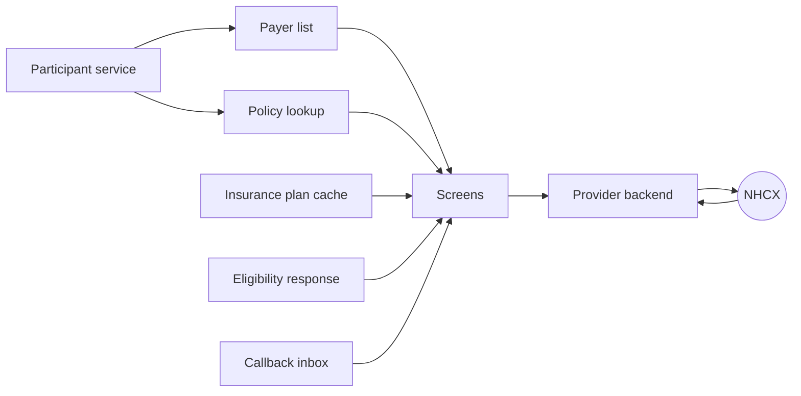
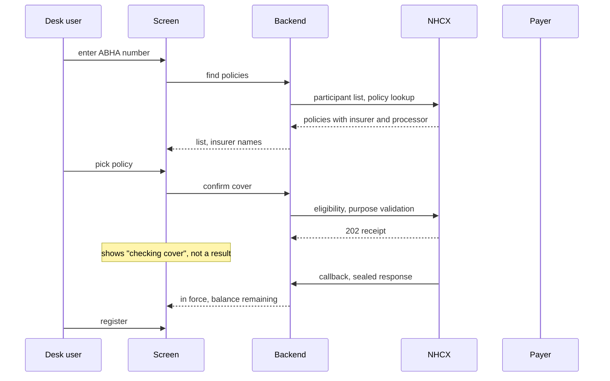
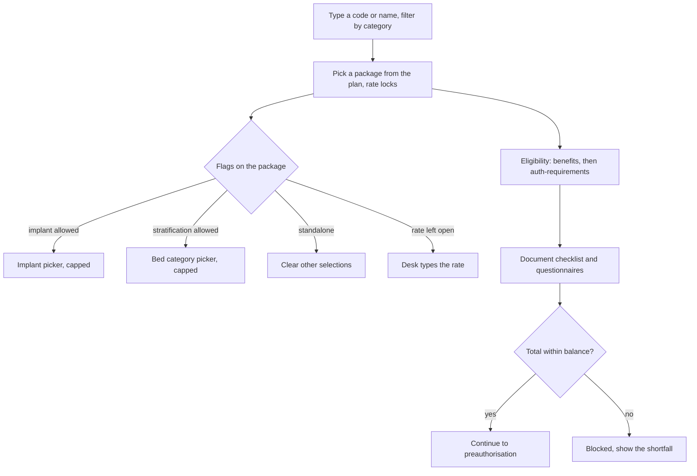
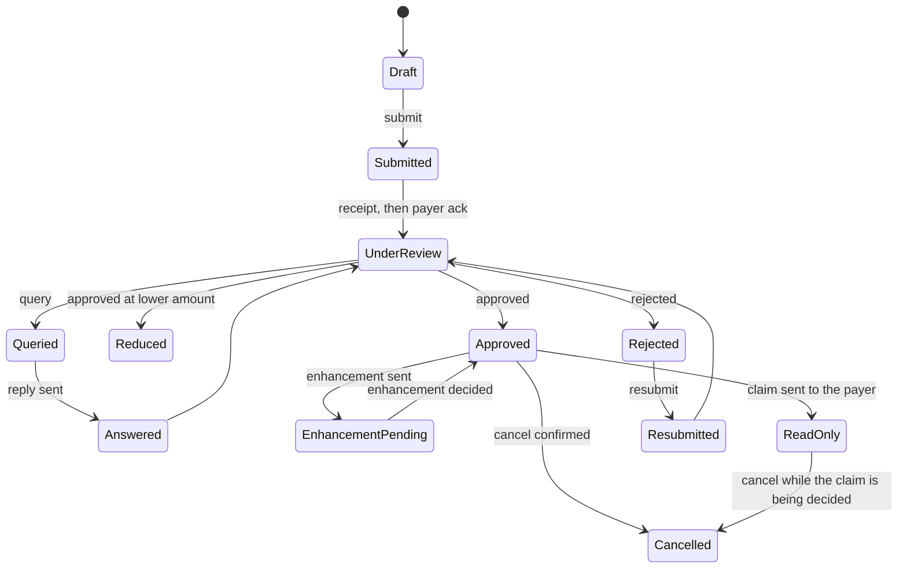
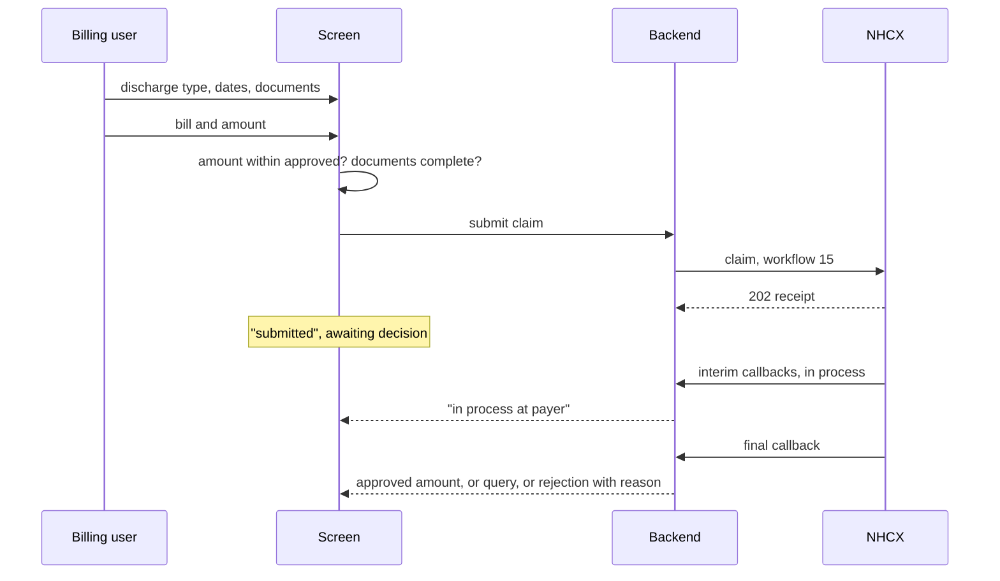
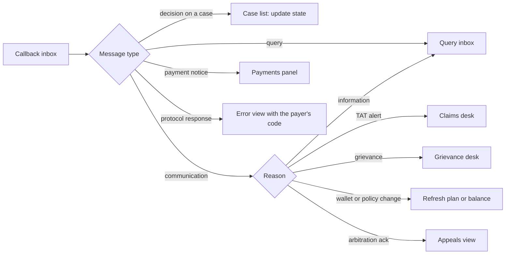

# Provider UI guide

This chapter is about the screens. Everything before it said what the provider system calls and what goes in the bundle. This says what the person at the desk sees, what they type, what they must not be allowed to type, and where each piece of data on the screen comes from. It is written for the product owner and the front-end engineer, and it is organised as seven flows and a settings screen across the same ground the rest of the section covers.

Two rules run through every screen.

**Nothing the exchange already knows is typed.** Payer names, policy numbers, package names, rates, add-on codes, document lists and questionnaire text all come from elsewhere. From the participant service, the policy lookup, the insurance plan or the eligibility response. A field the user can edit is a field the payer can reject.

**The screen never shows a decision the exchange has not sent.** Submitting is not approval. Every status on every screen is derived from a callback that was received, decrypted and stored, never from the fact that a request went out.

That rule has a consequence which is easy to miss. A case the payer has not answered yet exists nowhere in the callback inbox, because nothing has come back. So a system that builds its case list only from received callbacks cannot show a waiting case. The case vanishes between submission and answer, which is the one moment the user most needs to see it. **Keep a record of what you sent as well as what came back.** Store, per request, the action, the protected header, the bundle and the exchange's receipt. Build every case screen from the two halves together. Sent with nothing back is the waiting state, and it is a state you have to be able to render.

A case is keyed by the HMIS's own case or claim number, which exists before anything is sent. It is not keyed by a correlation ID: every send on the case, each follow-up, query answer and Task included, carries a correlation ID of its own, and the case remembers every one so a callback on any of them finds it. The payer's own case or preauthorisation number arrives later, on the answer. Show the payer's number to the user, since that is the number they will quote on the phone, and keep correlation IDs to the Logs tab. Screen addresses are yours to choose; the chapter does not prescribe them.

## Where the data comes from

| On screen | Comes from | Editable |
| :---- | :---- | :---- |
| Payer name | Participant list, filtered by role | Pick from list |
| Policy, member ID, product | Policy lookup | Pick from list |
| Cover in force, balance remaining | Eligibility response, purpose validation | No |
| Approved amount, reduction note | Claim response on the answer | No |
| Category, package, rate | Insurance plan | Pick from list; rate fixed unless the plan leaves it open |
| Add-ons allowed and their limits | Insurance plan flags | Pick within limits |
| Required documents, questionnaires | Eligibility response, purpose auth-requirements; plan | No; answer, do not edit |
| Case status | What was sent, plus the callback inbox | No |
| Payer's query text, decision, reason | Callback inbox | No |
| UTR, deductions, net paid | Payment notice callback | No |
| Clinical findings, history, diagnosis, care team | The HMIS record | Yes, in the HMIS |
| Bill number, date, amount claimed | Hospital billing | Yes, within the approved amount |

## The case screen

One screen per case, in tabs, in this order: **Overview** (the eligibility answer, the member, the wallet), **Pre-authorisation**, **Claim**, **Communication**, **Payments** and **Logs**. There is no separate tab for line items, the insurance plan, verification, validation or predetermination: lines, the plan's package picker, proof of presence and the coverage checks all sit on the Pre-authorisation tab. Claim and Payments appear only once a pre-authorisation has been raised; a link to either before that opens Pre-authorisation.

**A dot on a tab when the payer has sent something to look at.** Communication, for an open query or a message received since the tab was last opened. Pre-authorisation and Claim, when the leg is queried or the payer's answer arrived since. Payments, for a notice since. The first opening of a case counts as everything seen, and "seen" is kept per browser.

**Correlation ids and transaction ids appear on Logs and nowhere else.** Logs lists every message on every thread of the case, newest first: when, direction, message, workflow id, a status chip, the correlation id as the bare code, and the payer's disposition. Remember every correlation id a case sends on, so the list can be built. The desk quotes the payer's case number, never a correlation id.

**Refresh or poll is the integration's choice.** By default the screen has a manual Refresh button that reads again what the callbacks have stored. An integration may poll its own store instead. Neither sends anything to the exchange; asking the payer where a case stands is the status enquiry, a separate action.

**The Overview wallet** reads sum insured, utilised and balance only from the eligibility answer's benefit, never from a package rate, which produces negative balances. The validation card says when the insurance plan was fetched and offers to fetch it again.

**Several members on one cover.** The desk chooses the patient on cards, one per member, each with the payer's photo or an initials avatar: select one card, then one Continue button.

## Find the patient and register

**Screen.** One search box with a type selector: ABHA number, member ID, mobile. A results list showing the insurer name for each policy found. A confirm-cover panel that fills after the user picks a policy: in force or not, balance remaining, and the payer's own sentence about the policy shown verbatim. A register button that is disabled until cover is confirmed.

**What the UI enforces.** Try identifiers in order of strength and tell the user which one matched. The balance remaining is the allowed amount less the amount already used, both of which the eligibility answer carries as money values on the benefit. Show that subtraction, not the allowed amount on its own: the allowed amount alone reads as more cover than the patient has. Group digits the Indian way, so four hundred and fifty thousand reads as 4,50,000, and give the figure a word beside it rather than a bare number. Disable registration when the policy is not in force or the limit is exhausted, and say why in the payer's words.

**What the backend does behind it.** Resolves the processor code from the policy and stores it against the admission. The screen never shows the difference between insurer and processor, but every later call depends on it.

**When the card has several members.** A family policy answers with one member per Coverage. Show one card per member, with the name, gender, year of birth and relationship the payer returned, and mark the one the payer's response names as the member it answered about. Require the desk to say which member is the patient; nothing is taken as the patient until it does, and a member whose gender, year of birth or name disagrees with the patient on file is flagged on the card. Linking the admission is always an explicit act, never a side effect of the answer arriving.

**States the screen shows.** Searching, policies found, checking cover, cover confirmed, cover refused, registered.

## Plan the treatment

This is the line items card at the top of the Pre-authorisation tab, not a screen of its own. When the plan is not ready, the card offers to fetch it instead.

**Screen.** One table. A row to add a line from: a **Code** type-ahead that matches an item or package code or its name from two letters, a **Category** select (default "All", listing only categories that hold a quotable package, with counts of those) and a **Type** select (default "All": Procedure, Implant). Picking a match adds the line. The table edits the quantity, edits the rate only where the plan leaves it open, and removes lines and tiers; the plan's implants and ward or ICU tiers for the quoted procedures are offered under it. A live total against the balance remaining, turning red when it would exceed it. Once a line is quoted, two cards side by side: the **coverage benefits check** and the **authorisation requirements** check. A document checklist and questionnaire panel that populate once the packages are chosen.

**There are no custom line items.** Every line is quoted from the insurance plan, and the only price the desk types is an open rate. A cover benefit such as Ambulance, Blood or ICU is a limit of the policy, not a line, and is not offered.

**What the UI enforces.** Rate not editable, except where the master leaves the price open (no rate, or zero with no tier), which the screen says in words: "open" to type, "tiers only" when zero with tiers. One row per package per category, so a code listed under three categories is three rows and the desk adds the one the case is treated under. The screens call the payer's speciality a Category. A cyclic package already quoted offers "Add cycle" rather than refusing. Quantity capped. A standalone package clears any other selection and says so. A package flagged as needing a parent will not stay selected without one. A government-reserved package is not shown to a private hospital. When the total exceeds the balance, the submit path is closed, not merely warned.

**What the backend does behind it.** Reads the cached plan and derives the document checklist and questionnaires from the selected packages. Calls eligibility with purpose benefits to confirm the balance. Refreshes the plan if a policy-change communication has arrived since the cache was filled.

Everything this screen offers comes from the insurance plan. The specialties, the packages, the rates, the add-on allowances, the flags that govern them, the documents each package demands and the questionnaires attached to it are all in the plan. Fetch it and cache it as the Insurance Plan chapter describes.

The auth-requirements exchange is specified to return the required documents, and the rest of this section says so. The one published sample does not: it carries no benefit detail and no supporting-information requirements, and is indistinguishable from the plain benefits answer. So build the checklist from the plan, which certainly carries the requirements, and use the auth-requirements answer to confirm that authorisation is needed and to add anything it does return. A screen that depends on that answer alone will be empty against the only payer whose response has been published.

## Preauthorisation, query, enhancement, cancel

**Screen.** The Pre-authorisation tab, in this order: proof of presence when the payer or the plan requires it (stage `Preauth`); the line items card; the coverage benefits check and authorisation requirements side by side, once a line is quoted; the pre-authorisation details; the payer's forms; the documents; and the submit card, which moves to the top once the request has gone. The details are the pre-authorisation's own and do not wait for an admission: planned admission date (required), expected discharge date, ICD-10 diagnoses picked from the terminology (never typed) and the treating doctors with their roles. A linked admission only pre-fills a form not yet saved. A documents panel driven by the checklist from flow 2, with each mandatory item shown as missing until attached and the submit button disabled until none are. A forms card that is always on the screen once the case is on a plan: the questionnaires the quoted packages carry, the policy-wide forms, and an empty state saying the payer lists none for the quoted packages, so structured data can always be given and the desk never wonders where the forms went. After submission, a case panel with one status line and a timeline of everything sent and received.

**Documents and records.** A document the plan names can be taken off the leg's list with an X, and restored. The pre-authorisation or claim stage badge on documents and forms stays hidden until the authorisation requirements ruling has been asked for. "Filed as" offers only the NHCX document codes (`CD`, `POI`, `IMP` and the rest), never a plan's own codes, which are filed through their named row. A record attached "From records" is found by the case's ABHA number, listed with its name and its date and time written out ("18 Oct 2026, 8:41 am"), sent to the payer as FHIR, and opened for staff on its own HMIS page, never as its JSON.

**What the UI enforces.** Every mandatory document attached. Every questionnaire the plan demands answered. The planned admission date present. Total within balance. Under PMJAY, a biometric token or a consent response, and admission not more than one day ahead. Proof of presence is required when the payer's behaviour requires it or when the plan's policy documents carry the proof-of-identity code `ADN`; the next action then reads "Authenticate the beneficiary".

**The query inbox.** A queried case shows the payer's text, with the item it concerns highlighted, and a reply form that attaches documents and carries the case remarks. Reply goes out as a query answer under the query-answer workflow id, never as a new preauthorisation or a resubmission; the screen should make that impossible to confuse. A line-item query, carried on the payer's `ClaimResponse` with the queried items, and every query from a payer that asks on the case thread, are answered by sending the leg again from this tab. A standalone `CommunicationRequest` query is answered on the Communication tab.

**Enhancement.** Opens only on an approved case with no request in flight and no claim yet with the payer, offers only packages the plan marks enhanceable, and shows the already-approved items greyed alongside the new ones.

**Once the claim is with the payer, the pre-authorisation is read only.** No enhancement and no change: lines, details, documents and forms are all closed, and the screen says why. A claim still a draft, or refused at the door, leaves it open.

**Cancel.** A reason picker with the seven documented reasons and a free-text field that is required when the reason is Other. Offered while the pre-authorisation is live and the claim, if raised, is still being decided or queried. Hidden once the payer has decided the claim.

**Ask where it stands.** The status enquiry is offered on the pre-authorisation only while it is waiting for the payer's answer; once decided, it is asked of the claim. It is not offered for a payer that answers no status `Task`.

What each state shows the user: Submitted means "sent, no word yet", not approval. UnderReview appears only when the payer's receipt has come back. Approved shows the preauthorisation reference, the approved amount, and any reduction note verbatim.

Three fields on the answer are worth naming, because the response carries several amounts and picking the wrong one misstates the decision. The **approved amount** for the case as a whole is the benefit total on the response, and the same category per line gives the approved amount for each item. The submitted category alongside it is what you asked for, not what you were granted. Showing it as the decision is the classic error. The **preauthorisation reference** is the payer's own number for the case. The **reduction note**, and any other sentence the adjudicator wrote, arrives as process notes and is shown verbatim. The Preauthorisation Response chapter in the FHIR Reference gives the full shape.

## Discharge and claim

**Screen.** The Claim tab, in this order: proof of presence (stage `Discharge`, on the claim whenever the payer or plan asks for it); **Link the IPD admission**, which offers the admissions found by the case's ABHA number and which the claim needs; the discharge; documents and forms, under the same X and badge rules as the pre-authorisation; and the claim card. Once the pre-authorisation is approved and no admission is linked, the next action reads "Link the IPD admission". A discharge form: type (home, death, left against advice, discharged against advice), dates, and the documents that type requires. Then the claim form: bill number, date, bill attachment, amount claimed with the approved amount shown beside it, post-operative evidence. A single submit for the claim; under PMJAY the discharge is not a separate submission.

**What the UI enforces.** Amount claimed not above the approved amount. Discharge type chosen before the claim opens. Under PMJAY: a fresh biometric or the discharge consent; for a LAMA or DAMA leaving before surgery, the line items replaced by the stay line with the user told the approved packages are voided.

**States.** Draft, submitted, in process, forwarded, queried, approved, reduced, rejected, and refused at the door. A claim is never resubmitted. A claim the payer has decided offers no "send again"; a rejected claim offers only "Ask for a reprocess". A claim refused at the door never reached the payer, so it offers only "Send the claim again". "Ask where it stands" is offered on the claim once it has been raised.

## Appeal a decision

**Screen.** From a rejected claim, one reprocess form: the payer's reason shown at the top, a reason (`claimrejected` or `rejectiondisputed`), the justification text and a document attachment that is required. From a short-paid claim, a separate balance release form with an amount field capped at the difference. A notice of how many appeals remain, and, once the Committee has decided, a closed state with the decision. The reprocess decision arrives as a `ClaimResponse` on the Task reply and updates the claim.

**What the UI enforces.** A reprocess only on a rejected claim, refused otherwise with "Only a claim the payer has rejected can be sent back for reprocessing." No appeal without a document. Release amount never above the difference. Under PMJAY, the shortfall form stays disabled until the settlement notice has arrived and been acknowledged, and neither form reopens after a Committee decision.

## Payments

**Screen.** Per case, a payment panel listing each notice as it arrives, and on settlement the UTR as text on the page, gross, deductions itemised, net, and the shortfall against the claimed amount. A line saying whether the payment was posted to the hospital's bill and to which bill, with a button to post it again when it was not. Reconciliation staff copy the UTR, so a copy control beside it earns its place. The value still has to be readable without one: a UTR that exists only inside the `value` attribute of an input box is not on the screen. The same goes for every other figure the payer sent. An acknowledge button per notice. A reconciliation view across cases for accounts, filterable by date and payer, exportable.

**What the UI enforces.** There are two different acknowledgements here and the screen should not confuse them. The 202 receipt your callback returns is a transport acknowledgement, sent automatically the moment the notice arrives. Separately, the provider sends a real acknowledgement message back to the payer, a Task (workflow 17 under PMJAY), and the Payment and Communication chapter gives its shape. That one is a business act, so it belongs on the screen: one button per notice, and a clear indication once it has gone. Send it whether or not the user clicks, and show that it went. A rejected payment notice shows as not paid, in red, with the case kept open.

## Settings

**Screen.** Two cards an administrator sees. The participant: the code the deployment sends as, what the registry holds for it (status, registered name, roles, callback endpoint) with a re-check, and an "Update the registry" action when the endpoint on record is not the one this deployment answers at. The encryption key: three slots, active, staged and previous, each with its fingerprint and certificate expiry, and whether the registry's certificate is the active one. Rotation is stage (paste the new key and certificate; they go to the gateway and are never shown again), register (publish the staged certificate), activate (the staged key opens messages, the old key moves to previous) and retire (forget the previous key), with no restart.

**What the UI enforces.** The private key is never echoed, logged or audited. A staged key opens nothing until activated. Activation is refused while the gateway holds its key inline rather than in a file, with the reason.

## The case list and the inbox

**Screen.** Every case in one list with its current state and the time of the last callback, sortable by what needs action: queries waiting for an answer, turnaround alerts, payment notices unacknowledged. A separate inbox for payer communications by reason: information requests, turnaround alerts, grievances, wallet changes, policy changes, arbitration acknowledgements, each routed to the desk that owns it.

**What the UI enforces.** Nothing on this screen is entered. It is a view over what was sent and what came back, and it is honest about silence. A case with no answer for longer than expected shows as waiting, with how long it has been waiting, and never as any decision. Do not offer a chase button unless you have implemented the status exchange behind it, because a control that does nothing is worse than no control. A Refresh button that reads the stored state again is not a chase and is the default. The list header stays on one line: title, filters and buttons. One search box finds a case by patient name, member id, claim number, policy code or ABHA number, and a payer filter sits beside the date, its list of payers deduplicated by the numeric part of the participant code.

**The Communication tab, when it is empty,** shows an icon and one plain line: "No messages from the payer yet. Its questions and notices for this case will appear here." Never protocol words such as `CommunicationRequest` or `ClaimResponse`.

## Two things that will break a naive screen

**A delivery failure arriving on a case that already has an answer.** A report on the error endpoint, or a protocol response saying a message could not be opened, is about one message. It is not about the case. A screen that simply shows the most recent thing that arrived will turn an approved preauthorisation into an error, which is wrong and alarming. Show the failure as a flag beside the state, not as the state.

**The same answer delivered twice.** The exchange retries, so a callback can arrive more than once with the same call ID. A timeline built by appending everything received will show the payer approving the case twice. Treat a repeated call ID as the message you already have, and if the timeline mentions it at all, mention it as a repeat.

## Errors the user should see

Show the payer's error as the payer wrote it, with the code, and add one line saying what the user can do. The reference payer's messages already name the field: "Invalid procedure code received as X", "Insufficient wallet balance", "Existing case in progress for case number Y". Do not translate them into a generic failure. A protocol response, meaning the message could not be opened, is a system problem and goes to the integration team, not to the desk.
